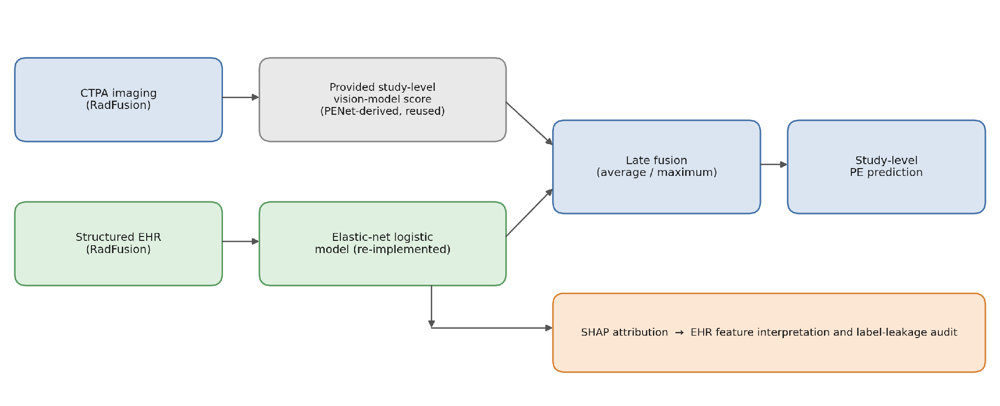
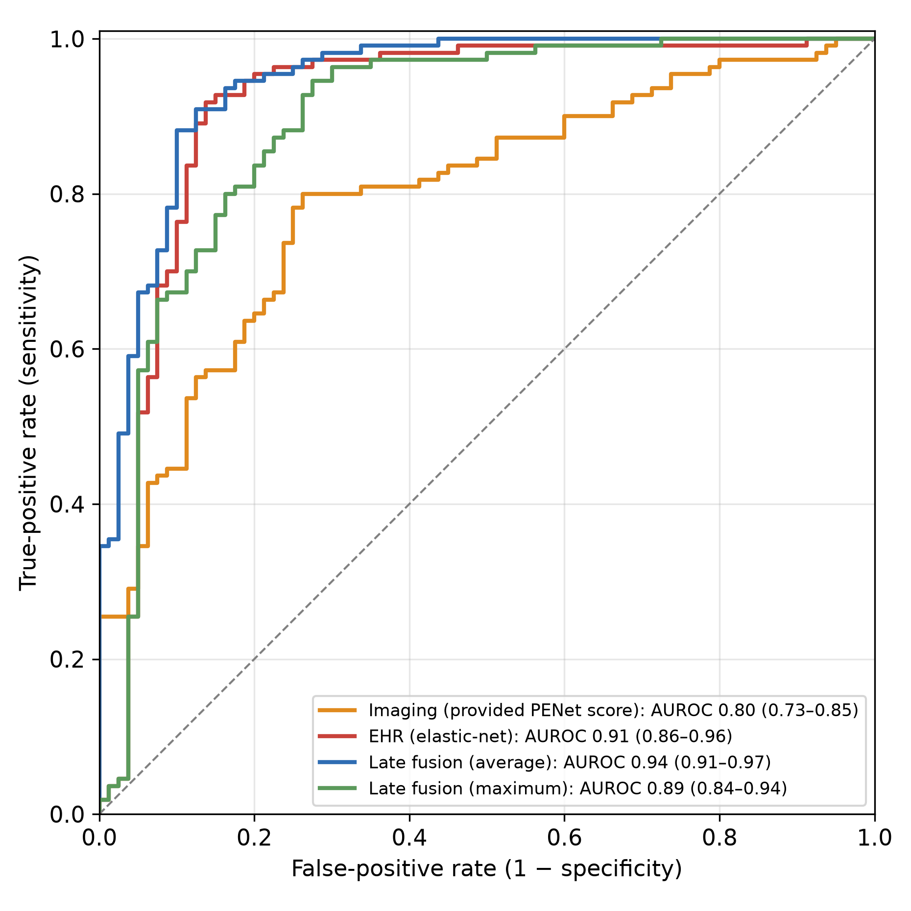
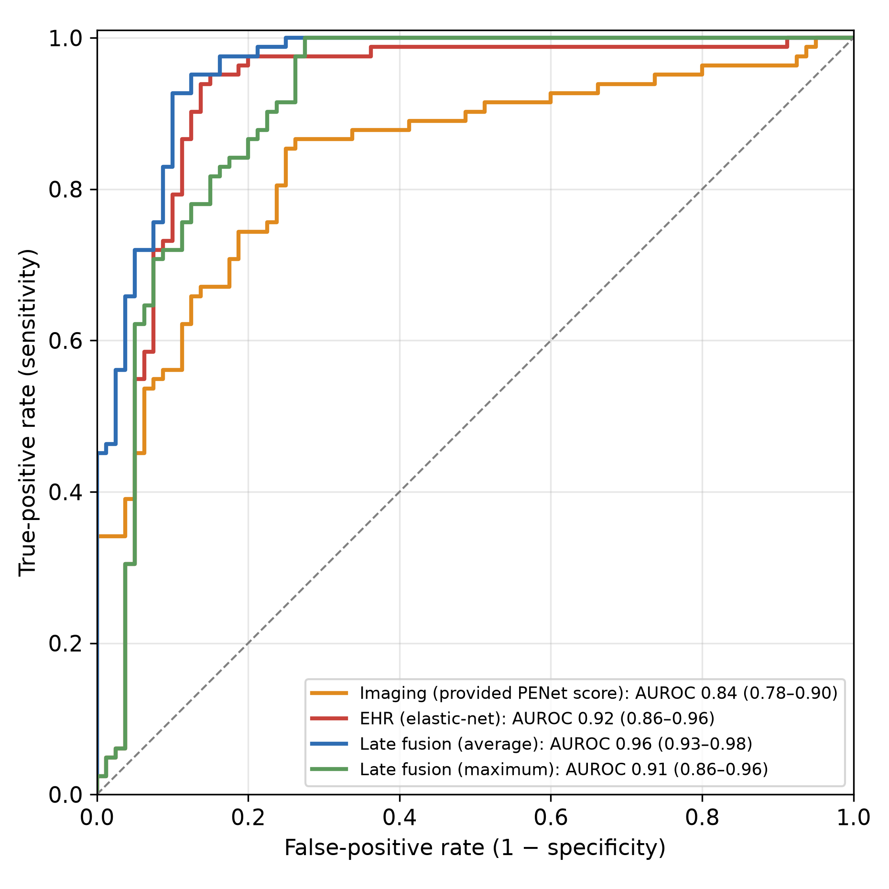
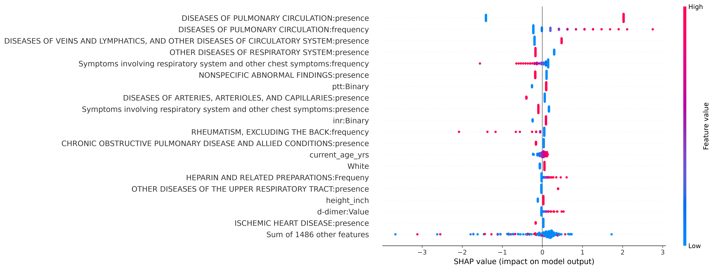
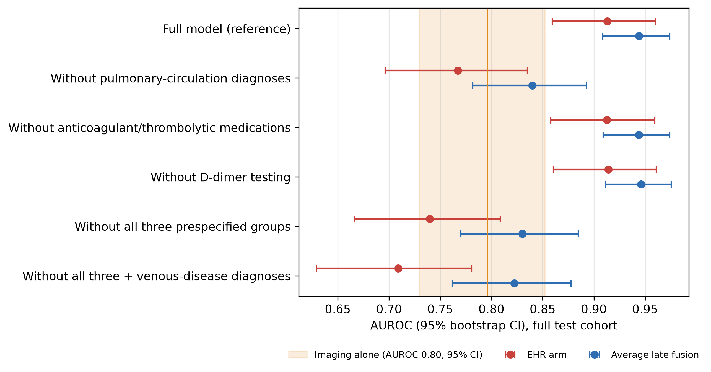

**Independent Reproduction and Label-Leakage Audit of Multimodal Pulmonary Embolism Detection on the RadFusion Benchmark**

Zain A. Jaffar ^1^

^1^ School of Arts and Sciences, Rutgers University, New Brunswick, USA

Corresponding author: Zain A. Jaffar, zaj14@scarletmail.rutgers.edu

# Abstract

**Introduction:** The RadFusion benchmark showed that combining computed tomography pulmonary angiography (CTPA) with structured electronic health record (EHR) data improves pulmonary embolism (PE) detection, but it has not been independently reproduced or audited. We reproduced its multimodal late-fusion result and quantified how much depends on EHR features that may encode the diagnosis itself.

**Methods:** We used RadFusion (1,837 CTPA studies; held-out test set of 190 studies, 110 [57.9%] PE-positive). The imaging input was held fixed by reusing the study-level PENet score distributed with the benchmark. We re-implemented the EHR arm as an elastic-net logistic model and combined the two arms by average and maximum late fusion. We report the area under the receiver operating characteristic curve (AUROC) with bootstrap 95% confidence intervals and paired DeLong tests. The EHR arm was audited with SHapley Additive exPlanations (SHAP) and a feature-exclusion ablation of prespecified leakage-candidate groups: pulmonary-circulation diagnoses, anticoagulant or thrombolytic medications, and D-dimer testing.

**Results:** Average fusion reached an AUROC of 0.94, compared with 0.91 for the EHR arm (difference 0.031; p=0.042) and 0.80 for imaging alone. The pulmonary-circulation diagnosis grouping, which contains PE itself, accounted for 40.8% of total SHAP importance. It was present in 93.3% of PE-positive versus 16.2% of PE-negative training studies. Removing its two features lowered the EHR AUROC to 0.77 and the fusion AUROC to 0.84 (both p<0.001), after which fusion no longer differed significantly from imaging alone (p=0.118). Removing anticoagulant or D-dimer features changed the AUROC by at most 0.002.

**Conclusions:** The benchmark result reproduces. However, much of its EHR contribution depends on a single diagnosis grouping that contains the target condition, so reported multimodal gains may overstate pretest predictive value. Releasing index-relative feature timestamps and routinely reporting feature-exclusion sensitivity analyses would strengthen multimodal benchmarks.

**Keywords:** pulmonary embolism, reproducibility, multimodal machine learning, late fusion, label leakage, interpretability, electronic health records, computed tomography pulmonary angiography

# Introduction

Pulmonary embolism (PE) is a common and potentially fatal manifestation of venous thromboembolism, which ranks among the leading causes of cardiovascular death worldwide [1,2]. Diagnosis rests on CT pulmonary angiography (CTPA), interpreted together with clinical context recorded in the electronic health record (EHR) and structured by pretest-probability rules such as the Wells score, the revised Geneva score, the PE rule-out criteria (PERC), and the YEARS algorithm with or without age-adjusted D-dimer thresholds [2-7]. Timely interpretation is limited by radiologist workload and workforce shortfalls [8]. Diagnostic-support tools that are both accurate and interpretable could therefore help extend expert-level reading to more settings.

Deep learning for PE has advanced along two tracks. Imaging models range from vessel-aligned convolutional networks [9] and two-stage detectors [10] to end-to-end volumetric classifiers such as PENet [11], purpose-built detection networks [12], and multitask imaging models [13]. Separately, EHR-only models predict PE from structured clinical data [14]. The RadFusion benchmark combined the two and showed that multimodal fusion of CTPA and EHR outperforms either modality alone [15,16]. Even so, most approaches remain unimodal and opaque. This limits clinical trust, because such models neither reflect the multimodal reasoning of radiologists nor expose the basis of a prediction [17].

Three gaps motivate this work. First, independent reproductions of medical machine-learning results are uncommon, even though reproducibility is a prerequisite for trustworthy translation [18]. Second, interpretability is rarely evaluated alongside performance. Third, and specific to this benchmark: when a model draws on longitudinal EHR features, some of those features may be recorded at the same time as, or after, the diagnosis they are used to predict. This is a form of target (label) leakage, a well-described cause of optimistic performance in machine learning [19,20].

We therefore hold the imaging input fixed by reusing the study-level vision-model scores distributed with the benchmark, re-implement the EHR arm independently, and reproduce the late-fusion step. We then audit the resulting EHR model with feature attribution and quantify the audit with a feature-exclusion ablation. Throughout, "detection" denotes study-level classification (PE present versus absent), not embolus localization. Our contributions are:

- an independent reproduction of RadFusion late fusion with the imaging input held fixed, so that the reproduction isolates the EHR arm and the fusion rule;
- uncertainty-quantified reporting: bootstrap confidence intervals, paired DeLong tests, and operating points with likelihood ratios;
- a label-leakage audit that measures how much of the EHR and fusion discrimination depends on features that may encode the diagnosis.

We make no claim of a novel architecture or of state-of-the-art performance.

# Materials & Methods

**Figure 1** summarizes the analysis pipeline.

## Study design and reporting

This is a retrospective secondary analysis of a public, de-identified benchmark, reported according to the TRIPOD+AI statement [21]. No new data were collected, so institutional review board approval was not required.

## Data source, participants and selection

We used the Stanford AIMI RadFusion dataset [16], which contains 1,837 CTPA studies from 1,794 patients, retrospectively assembled at a single academic medical center. Each study has a study-level PE label (PE present or absent), a PE subtype for positive studies (central, segmental, or subsegmental), a predefined split assignment (training, validation, or test), and paired structured EHR features. Patient selection, the reference-standard labeling procedure, and split construction were performed by the dataset authors and are described in the source publications [11,15,16]. According to that documentation, EHR features summarize the 12 months preceding the CT examination. ICD diagnosis codes recorded under the same encounter number as the CT examination, or within 24 hours before it, were removed by the dataset authors to limit leakage [15]. Diagnosis codes were collapsed into diagnosis groupings, and groupings present in fewer than 1% of training studies were removed before release. The released tables contain aggregated presence and frequency indicators, not timestamps relative to the index examination.

We applied no additional inclusion or exclusion criteria: every one of the 1,837 studies was analyzed. **Table 1** shows the cohort by split. The splits are those used to develop PENet [11]. The training split is 34.9% PE-positive, whereas the validation and test splits are enriched (56.0% and 57.9%), so the test-set prevalence exceeds that of the full cohort (39.5%). The test set comprises 190 studies (110 PE-positive, 80 PE-negative); 28 of its positive studies are subsegmental.

**Sample size.** No a priori sample size calculation was performed. This reproduction used the complete RadFusion benchmark and its predefined splits, which fixes the sample size. Sampling was therefore a census of the released dataset rather than a random or consecutive sample drawn by us. The precision achieved is reported as 95% confidence intervals for every estimate. For a test set of 110 positive and 80 negative studies, the AUROC intervals have half-widths of about 0.03–0.07.

## Imaging arm (provided vision-model scores)

The imaging input was the study-level probability distributed with RadFusion (the `pred` column of the released vision file). It was generated by the benchmark's PENet three-dimensional convolutional network [11]. No imaging model was trained, fine-tuned, or evaluated for any reported result. Reusing the released scores keeps the imaging input identical to the reference benchmark, so any divergence from the published result is attributable to the re-implemented EHR arm and the fusion step. Imaging performance reported here is therefore inherited from the benchmark, not established by this study.

## EHR feature processing

The six released EHR tables were demographics, inpatient medications, outpatient medications, ICD diagnosis groupings, laboratory tests, and vital signs. Medications are represented as presence and frequency across 641 drug classes, laboratory tests as presence and latest value for 22 tests, and 141 diagnosis groupings as presence and frequency. Each table was processed as follows:

1. Fifty-one studies that appeared twice with byte-identical rows in five tables were de-duplicated.
2. Constant (zero-variance) columns were removed.
3. Each remaining feature was standardized to zero mean and unit variance, following the reference implementation [15].

Standardization used the mean and standard deviation across all 1,837 studies. This step does not use labels, and a sensitivity analysis fitted standardization on the training split only. The tables were then joined on the study identifier. The joined matrix contained no missing values, so no imputation was required. No further frequency filter was applied beyond the <1% filter already applied by the dataset authors. **Table 2** reports the feature counts at each step; the final feature matrix contained 1,505 features.

## EHR models

The primary EHR model was an elastic-net-regularized logistic regression (scikit-learn LogisticRegression; saga solver). Its hyperparameters were fixed a priori to those of the reference implementation [15]: inverse regularization strength C=0.1, L1 ratio 0.99, a maximum of 1,000 iterations, and random seed 0. Class imbalance was handled with balanced class weights, which are inversely proportional to class frequency in the training split. The model was fitted on the training split only (1,454 studies). The validation split was not used for fitting or model selection, and the test split was used only for evaluation. Of the 1,505 input features, 199 received a non-zero coefficient.

A sensitivity analysis tuned the same model on the training split by five-fold stratified cross-validated grid search, scored by AUROC, over C ∈ {0.01, 0.1, 1.0} and L1 ratio ∈ {0.5, 0.9, 0.99}. As a secondary EHR estimator, used for the specificity-oriented operating point in Table 5, a support-vector classifier (SVC) was fitted: radial basis function kernel, C=1.0, γ="scale", no class weighting, with probability estimates from scikit-learn's internal Platt scaling. The SVC hyperparameters were library defaults and were not tuned. Multidimensional scaling was used for exploratory visualization only.

## Late fusion

Study-level imaging and EHR probabilities were combined by two late-fusion rules: the arithmetic mean (average fusion) and the elementwise maximum (maximum fusion). This is consistent with prior evidence that late combination performs competitively for multimodal PE detection [15]. Neither rule has learned parameters, so no fusion weights were fitted on any split.

## Interpretability

We computed exact SHapley Additive exPlanations (SHAP) values for the elastic-net model with the linear explainer [22], using the training split as the background distribution. Values are expressed in log-odds units. Each feature's global importance was summarized as its mean absolute SHAP value over the 190 test studies, and as its share of the summed mean absolute SHAP value across all features. Attribution was applied to the EHR arm only; because the imaging scores were not generated here, no saliency maps accompany the imaging arm.

## Label-leakage audit

Before any ablation result was computed, we prespecified three leakage-candidate feature groups using explicit clinical criteria:

- **(a) Diagnosis groupings whose code range contains the target condition.** The "diseases of pulmonary circulation" grouping contains PE (ICD-9-CM 415.1; ICD-10-CM I26) [23]. This group has two features: presence and frequency.
- **(b) Treatments for the target condition.** Inpatient and outpatient heparin and related preparations, coumarin-type anticoagulants, direct factor Xa inhibitors, direct thrombin inhibitors, and thrombolytic enzymes: 20 features.
- **(c) Diagnostic workup for the target condition.** D-dimer presence and latest value: 2 features.

A fourth, secondary group was defined by the same logic: **(d) venous-disease diagnoses** (the grouping containing deep-vein thrombosis; 2 features). It captures a condition that is typically diagnosed during the PE workup. The exact column list is given in Supplementary Table S2 and is released with the code.

The audit had three steps:

1. **Attribution.** Features were ranked by mean absolute SHAP value, and each group's share of total attribution was computed.
2. **Descriptive association.** For each group, the proportion of PE-positive and PE-negative studies with the feature present was compared by Fisher's exact test.
3. **Feature-exclusion ablation.** The elastic-net model was refit with an identical configuration after removing each group in turn, then groups (a)–(c) together, then (a)–(d) together. Fusion was recomputed for each variant. Each ablated model was compared with the full model, and each ablated fusion with imaging alone, by paired DeLong test.

A fall in discrimination after exclusion shows how much the model relies on those features. It does not by itself prove leakage, because a documented history of venous thromboembolism is also a legitimate risk factor [3].

## Statistical analysis

Discrimination was summarized by AUROC and average precision (area under the precision-recall curve, AUPRC). The 95% CIs for both came from 2,000 stratified bootstrap resamples of the test set (percentile method; seed 42). As a check, the bootstrap and DeLong standard errors for AUROC agreed within 0.001. Paired comparisons of correlated AUROCs used the DeLong test [24], which reports the difference with its 95% CI and a two-sided p-value.

At a fixed, untuned probability threshold of 0.5 we report:

- sensitivity, specificity, positive and negative predictive values (PPV, NPV), and accuracy, each as n/N (%) with Wilson score 95% CIs [25];
- F1 score;
- positive and negative likelihood ratios (LR+, LR−), with 95% CIs by the log method [26].

Associations between binary features and the PE label were tested with Fisher's exact test.

The full test cohort was the primary analysis. The non-subsegmental subset (test studies excluding those whose PE was confined to subsegmental vessels; n=162) was secondary, because subsegmental clots are the smallest and most diagnostically ambiguous and are conventionally analyzed separately in this benchmark [15]. Tests were two-sided with α=0.05. No adjustment for multiple comparisons was made, so p-values are interpreted as exploratory.

## Software

Analyses were run in 2026 with:

- Python 3.11.15
- scikit-learn 1.9.1 [27]
- SHAP 0.51.0 [22]
- NumPy 2.4.6
- pandas 3.0.6
- SciPy 1.17.1
- matplotlib 3.11.2

The RadFusion dataset is available through the Stanford AIMI Shared Datasets program under its data-use terms; the author does not redistribute it. All analysis code, the exact leakage-candidate column list, library versions, and random seeds are available at https://github.com/ZainJaffar06/radfusion-pe-reproduction. Every reported number is regenerated by a single script.

## Exploratory slice-level classifier (not part of any reported result)

Separately from this reproduction, we explored a compact candidate imaging backbone: a YOLOv8n-cls image classifier (Ultralytics), fine-tuned for two epochs at 224×224 pixels on individual CTPA slices labeled as PE or no PE, and evaluated at the slice level only. Its outputs were never aggregated to study level, never combined with the EHR arm, and contribute to no result, table, or figure in this article. Slice-level accuracy under strong class imbalance approaches the majority-class base rate and is not a meaningful measure of PE detection, so no slice-level results are reported. The code is included in the repository for transparency.

# Results

## Cohort and features

**Table 1** shows the cohort by split. **Table 2** shows the features retained after each preprocessing step.

## Reproduction of the benchmark result

**Table 3** summarizes discrimination, and **Figures 2 and 3** show the ROC curves.

On the full test cohort, average late fusion achieved an AUROC of 0.94 (95% CI 0.91–0.97). This compares with 0.91 (95% CI 0.86–0.96) for the EHR arm, 0.89 (95% CI 0.84–0.94) for maximum fusion, and 0.80 (95% CI 0.73–0.85) for the provided imaging scores.

On the non-subsegmental subset, the corresponding values were:

- average fusion: 0.96 (0.93–0.98)
- EHR arm: 0.92 (0.86–0.96)
- maximum fusion: 0.91 (0.86–0.96)
- imaging: 0.84 (0.78–0.90)

The full-cohort fusion AUROC closely matches the 0.947 (95% CI 0.946–0.948) reported for the benchmark's best multimodal model, a late elastic-average fusion over the same PENet scores [15]. Because both analyses use the same released imaging scores, this agreement isolates the re-implemented EHR arm and the fusion step.

## Paired comparisons between arms

**Table 4** gives the paired DeLong comparisons.

On the full cohort:

- **Average fusion vs. EHR arm:** +0.031 (95% CI +0.001 to +0.061); p=0.042. This is nominally significant but would not survive a multiplicity correction, so it should be read as modest.
- **Average fusion vs. imaging:** +0.148 (95% CI +0.086 to +0.210); p<0.001.
- **EHR arm vs. imaging:** +0.117 (95% CI +0.035 to +0.199); p=0.005.
- **Maximum fusion vs. EHR arm:** −0.021 (95% CI −0.052 to +0.009); p=0.175 (no significant difference).
- **Average vs. maximum fusion:** +0.052 (95% CI +0.023 to +0.082); p<0.001 (average fusion higher).

The non-subsegmental subset showed the same pattern: average fusion vs. EHR arm +0.041 (95% CI +0.009 to +0.072); p=0.013.

## Operating points

**Table 5** reports the operating-point metrics at a threshold of 0.5.

**Specificity-oriented EHR (SVC) configuration:** 73 true positives, 5 false positives, 37 false negatives, 75 true negatives.

- sensitivity 73/110 (66.4%; 95% CI 57.1–74.5)
- specificity 75/80 (93.8%; 95% CI 86.2–97.3)
- LR+ 10.6 (95% CI 4.5–25.1)

**Sensitivity-oriented maximum-fusion configuration:** 106 true positives, 27 false positives, 4 false negatives, 53 true negatives.

- sensitivity 106/110 (96.4%; 95% CI 91.0–98.6)
- NPV 53/57 (93.0%; 95% CI 83.3–97.2)
- LR− 0.05 (95% CI 0.02–0.15)

## Feature attribution

**Figure 4** shows the SHAP summary, and **Supplementary Figure S1** shows the global importance ranking. **Table 6** lists the ten highest-ranked features.

The two pulmonary-circulation diagnosis features ranked first and second, with mean absolute SHAP values of 1.76 and 0.32 log-odds. Together they accounted for 40.8% of total attribution. The venous-disease grouping ranked third (5.9%).

The other prespecified groups contributed little:

- anticoagulant and thrombolytic features: 1.0% in total (highest rank 15)
- D-dimer features: 0.9% (highest rank 18)

## Label-leakage audit

**Table 7** shows how common each leakage-candidate feature was by PE status.

A pulmonary-circulation diagnosis was recorded in 474/508 (93.3%) PE-positive versus 153/946 (16.2%) PE-negative training studies (odds ratio 72.3; p<0.001). In the test set the corresponding figures were 97/110 (88.2%) versus 11/80 (13.8%).

For the other groups:

- **Anticoagulant or thrombolytic exposure:** similar in the training split (130/508 (25.6%) vs 202/946 (21.4%); p=0.077) but more common among PE-positive test studies (40/110 (36.4%) vs 12/80 (15.0%); p=0.002).
- **D-dimer testing:** did not differ by PE status in either split.

**Table 8** and **Figure 5** show the feature-exclusion ablation.

Removing only the two pulmonary-circulation features lowered the EHR AUROC from 0.91 to 0.77 (95% CI 0.70–0.84). The difference was −0.146, 95% CI −0.216 to −0.076 (p<0.001). The average-fusion AUROC fell from 0.94 to 0.84 (95% CI 0.78–0.89), a difference of −0.104, 95% CI −0.156 to −0.053 (p<0.001). With these features excluded, fusion no longer differed significantly from imaging alone (difference +0.044; p=0.118), whereas the full model's advantage was +0.148 (p<0.001).

Removing the anticoagulant/thrombolytic group or the D-dimer group alone changed neither the EHR nor the fusion AUROC by more than 0.002 (all p≥0.142).

Removing groups (a)–(c) together gave:

- EHR AUROC 0.74 (95% CI 0.67–0.81)
- fusion AUROC 0.83 (95% CI 0.77–0.88); fusion vs. imaging alone, p=0.243

Additionally removing the venous-disease group gave:

- EHR AUROC 0.71 (95% CI 0.63–0.78)
- fusion AUROC 0.82 (95% CI 0.76–0.88)

The non-subsegmental subset showed the same pattern (**Table 8**).

## Sensitivity analyses

**Supplementary Table S1** reports the sensitivity analyses.

- **Standardization fitted on the training split only:** EHR AUROC 0.89, fusion AUROC 0.94.
- **Cross-validated grid search:** selected C=0.1 and L1 ratio 0.99, the same as the reference configuration, and gave EHR 0.91 and fusion 0.94.
- **Grid search after excluding groups (a)–(c):** EHR 0.75 and fusion 0.83.

The ablation finding therefore does not depend on the fixed reference hyperparameters.

# Discussion

This independent reproduction supports three findings.

First, with the imaging input held fixed, the re-implemented EHR arm and fusion step recover the published benchmark result (0.94 against 0.947). This is the reproducibility claim of this work.

Second, the ordering of the arms matches the benchmark. Average fusion is highest, and maximum fusion performs no better than the EHR arm, so the choice of fusion rule matters. The advantage of average fusion over the EHR arm is small and only nominally significant.

Third, and most consequential, most of the EHR contribution depends on a single diagnosis grouping that contains the target condition. Without that grouping, the multimodal model is not demonstrably better than the imaging model alone.

## Temporal label leakage in the EHR arm

Multimodal benchmarks that pair imaging with longitudinal EHR features assume the EHR features are available before the index examination. The RadFusion authors took explicit steps toward this: they restricted features to the preceding 12 months and removed diagnosis codes from the index encounter and the preceding 24 hours [15]. Our audit indicates that those steps may not fully remove diagnosis-related signal.

A pulmonary-circulation diagnosis was present in 93.3% of PE-positive but only 16.2% of PE-negative training studies. A prior history of venous thromboembolism is a legitimate risk factor, weighted as such in the Wells and revised Geneva scores [3,4]. However, a prior pulmonary-circulation diagnosis in more than nine of ten patients with PE is far higher than a history-only feature would plausibly produce. Several processes could explain it: codes carried from linked encounters that fall outside the encounter-number rule; problem-list or billing entries back-dated to the diagnostic episode; or repeat imaging in patients with known or recently treated PE.

The released tables cannot distinguish these explanations, because they carry no timestamps relative to the index study. The ablation nevertheless bounds the practical consequence. Two of 1,505 features account for an EHR AUROC difference of 0.15 and a fusion difference of 0.10. Once they are removed, the fusion gain over imaging alone becomes small and statistically uncertain.

The anticoagulant and D-dimer concerns raised in our initial attribution analysis were not borne out quantitatively. Removing either group left discrimination unchanged, and D-dimer testing was equally common in PE-positive and PE-negative studies. This is consistent with process-driven EHR signals, such as whether a test was ordered [28], being less informative here than diagnosis coding.

These results do not invalidate the benchmark or imply that its authors erred. They identify a verification step that the released data do not currently support. The EHR AUROC of 0.91 and the fusion AUROC of 0.94 are best read as upper bounds under the released feature definitions, not as estimates of pretest discrimination. The ablated values (0.77 and 0.84) are closer to a conservative lower bound. Excluding the pulmonary-circulation grouping also removes any legitimate history-of-PE signal it contains, so the true pretest value lies between these bounds.

## Implications for clinical deployment and model evaluation

In an imaging-informatics workflow, a late-fusion model would sit between study acquisition and the reading worklist, reordering studies for expert review rather than replacing it. A sensitivity-oriented operating point (sensitivity 0.96, NPV 0.93) suits triage, and a specificity-oriented point (specificity 0.94, PPV 0.94) suits confirmatory use. The leakage finding bears directly on both roles.

At the moment a CTPA enters the worklist, the diagnosis code the EHR arm relies on most would usually not yet exist for a first presentation of PE. The deployed model would therefore behave more like the ablated model than like the benchmark model. For evaluation, the lesson is that a reproduced AUROC, however close to the published value, does not validate the features that produce it. Attribution combined with a quantitative exclusion analysis is a cheap and informative complement to headline discrimination.

Predictive values here were measured at a test-set prevalence of 57.9%. This far exceeds that of routine suspected-PE populations; in a large prospective management study, PE was confirmed in about one in seven patients [6]. Only the likelihood ratios transfer across settings.

## Recommendations for multimodal benchmarking

We suggest five practices for multimodal medical-AI benchmarks that pair imaging with EHR data:

1. **Release index-relative timestamps.** Distribute feature timestamps relative to the index examination, or pre-computed variants censored at the index time, so users can verify that features are available at prediction time.
2. **Report exclusion analyses routinely.** Report a feature-exclusion or censored-feature sensitivity analysis whenever features could encode the target (diagnosis codes, treatments, and diagnostic tests for the target condition).
3. **Quantify uncertainty in comparisons.** Report CIs and paired tests (for example, DeLong) for between-arm comparisons, rather than point estimates alone.
4. **Follow reporting guidance.** Use TRIPOD+AI [21] and document how each EHR feature was derived.
5. **Compare against clinical rules.** Benchmark against established pretest-probability rules [3-7] at a realistic prevalence.

## Limitations

**Dataset.** Development and evaluation used a single-center benchmark with no external or prospective validation. The test set is enriched for PE (57.9%), which inflates predictive values. The leakage audit is limited by the released data. Without index-relative timestamps we can measure how much the model relies on the suspect features, but we cannot determine how much of that reliance is true leakage and how much is legitimate history. We also could not verify the preprocessing that generated the released imaging scores.

**Model.** This is a reproduction, not a novel architecture. The imaging AUROC is inherited from the benchmark, so any optimism in those scores propagates into the fusion results. The EHR discrimination (elastic-net) and the specificity-oriented operating point (SVC) come from different estimators, so Tables 3 and 5 do not describe a single model. Feature standardization in the reference implementation used feature distributions from all splits, although a training-only sensitivity analysis gave the same result.

**Statistical.** The advantage of average fusion over the EHR arm was nominally significant without adjustment for multiple comparisons. Operating points use an untuned 0.5 threshold, and neither probability calibration nor decision-curve analysis [29] was performed.

**Clinical.** The pipeline was not benchmarked against clinical pretest-probability rules. Subgroup and fairness performance across RadFusion's protected attributes was not assessed. The system is a research prototype and is not intended for clinical use.

# Conclusions

With the imaging input held fixed, an independently re-implemented EHR arm and late-fusion step recover the published RadFusion multimodal result (0.94 against 0.947). However, a diagnosis grouping that contains the target condition drives most of the EHR contribution. Removing two such features lowers the fusion AUROC to 0.84, and fusion then no longer differs significantly from imaging alone. Multimodal gains on this benchmark should therefore be read as gains under the released feature definitions, not as prospective pretest performance. Releasing index-relative feature timestamps, and routinely reporting feature-exclusion sensitivity analyses, would allow the temporal audit this question requires.

# Additional Information

**Human subjects:** All authors have confirmed that this study did not involve human participants or tissue. This study analyzed the publicly available, fully de-identified RadFusion dataset (Stanford AIMI Shared Datasets) under its data-use agreement; no new data were collected and no participants were contacted, so institutional review board approval was not required.

**Animal subjects:** All authors have confirmed that this study did not involve animal subjects or tissue.

**Conflicts of interest:** In compliance with the ICMJE uniform disclosure form, all authors declare the following: **Payment/services info:** All authors have declared that no financial support was received from any organization for the submitted work. **Financial relationships:** All authors have declared that they have no financial relationships at present or within the previous three years with any organizations that might have an interest in the submitted work. **Other relationships:** All authors have declared that there are no other relationships or activities that could appear to have influenced the submitted work.

**Author contributions:** Zain A. Jaffar conceived and designed the study, implemented the analysis, performed the statistical analysis and interpretation, prepared the figures and tables, and wrote and approved the final manuscript.

**Data availability:** The RadFusion dataset is available from the Stanford Center for Artificial Intelligence in Medicine and Imaging (AIMI) Shared Datasets program under its data-use terms. Analysis code, the leakage-candidate column list, library versions and random seeds are available at https://github.com/ZainJaffar06/radfusion-pe-reproduction.

**Acknowledgements:** The author thanks the Stanford Center for Artificial Intelligence in Medicine and Imaging for curating and releasing the RadFusion dataset. **Use of artificial intelligence:** An AI assistant (Claude, Anthropic) was used to help write the revision analysis code and to draft and edit revised text. The author reviewed and verified all code, results and text and takes full responsibility for the content of this article.

# References

1. Wendelboe AM, Raskob GE: Global burden of thrombosis: epidemiologic aspects. Circ Res. 2016, 118:1340-1347. 10.1161/CIRCRESAHA.115.306841
2. Konstantinides SV, Meyer G, Becattini C, et al.: 2019 ESC guidelines for the diagnosis and management of acute pulmonary embolism developed in collaboration with the European Respiratory Society (ERS). Eur Heart J. 2020, 41:543-603. 10.1093/eurheartj/ehz405
3. Wells PS, Anderson DR, Rodger M, et al.: Derivation of a simple clinical model to categorize patients probability of pulmonary embolism: increasing the models utility with the SimpliRED D-dimer. Thromb Haemost. 2000, 83:416-420. 10.1055/s-0037-1613830
4. Le Gal G, Righini M, Roy PM, et al.: Prediction of pulmonary embolism in the emergency department: the revised Geneva score. Ann Intern Med. 2006, 144:165-171. 10.7326/0003-4819-144-3-200602070-00004
5. Kline JA, Mitchell AM, Kabrhel C, Richman PB, Courtney DM: Clinical criteria to prevent unnecessary diagnostic testing in emergency department patients with suspected pulmonary embolism. J Thromb Haemost. 2004, 2:1247-1255. 10.1111/j.1538-7836.2004.00790.x
6. van der Hulle T, Cheung WY, Kooij S, et al.: Simplified diagnostic management of suspected pulmonary embolism (the YEARS study): a prospective, multicentre, cohort study. Lancet. 2017, 390:289-297. 10.1016/S0140-6736(17)30885-1
7. Righini M, Van Es J, Den Exter PL, et al.: Age-adjusted D-dimer cutoff levels to rule out pulmonary embolism: the ADJUST-PE study. JAMA. 2014, 311:1117-1124. 10.1001/jama.2014.2135
8. Rimmer A: Radiologist shortage leaves patient care at risk, warns royal college. BMJ. 2017, 359:j4683. 10.1136/bmj.j4683
9. Tajbakhsh N, Gotway MB, Liang J: Computer-aided pulmonary embolism detection using a novel vessel-aligned multi-planar image representation and convolutional neural networks. Medical Image Computing and Computer-Assisted Intervention – MICCAI 2015. Navab N, Hornegger J, Wells WM, Frangi AF (ed): Springer, Cham; 2015. 9350:62-69. 10.1007/978-3-319-24571-3_8
10. Yang X, Lin Y, Su J, Wang X, Li X, Lin J, Cheng KT: A two-stage convolutional neural network for pulmonary embolism detection from CTPA images. IEEE Access. 2019, 7:84849-84857. 10.1109/ACCESS.2019.2925210
11. Huang SC, Kothari T, Banerjee I, et al.: PENet—a scalable deep-learning model for automated diagnosis of pulmonary embolism using volumetric CT imaging. NPJ Digit Med. 2020, 3:61. 10.1038/s41746-020-0266-y
12. Lynch D, Suriya M: PE-DeepNet: a deep neural network model for pulmonary embolism detection. Int J Intell Netw. 2022, 3:176-180. 10.1016/j.ijin.2022.10.001
13. Ma X, Ferguson EC, Jiang X, Savitz SI, Shams S: A multitask deep learning approach for pulmonary embolism detection and identification. Sci Rep. 2022, 12:13087. 10.1038/s41598-022-16976-9
14. Banerjee I, Sofela M, Yang J, et al.: Development and performance of the pulmonary embolism result forecast model (PERFORM) for computed tomography clinical decision support. JAMA Netw Open. 2019, 2:e198719. 10.1001/jamanetworkopen.2019.8719
15. Huang SC, Pareek A, Zamanian R, Banerjee I, Lungren MP: Multimodal fusion with deep neural networks for leveraging CT imaging and electronic health record: a case-study in pulmonary embolism detection. Sci Rep. 2020, 10:22147. 10.1038/s41598-020-78888-w
16. Zhou Y, Huang SC, Fries JA, et al.: RadFusion: benchmarking performance and fairness for multimodal pulmonary embolism detection from CT and EHR [Preprint]. arXiv. 2021, 10.48550/arXiv.2111.11665
17. Singh A, Sengupta S, Lakshminarayanan V: Explainable deep learning models in medical image analysis. J Imaging. 2020, 6:52. 10.3390/jimaging6060052
18. McDermott MB, Wang S, Marinsek N, Ranganath R, Foschini L, Ghassemi M: Reproducibility in machine learning for health research: still a ways to go. Sci Transl Med. 2021, 13:eabb1655. 10.1126/scitranslmed.abb1655
19. Kaufman S, Rosset S, Perlich C, Stitelman O: Leakage in data mining: formulation, detection, and avoidance. ACM Trans Knowl Discov Data. 2012, 6:15. 10.1145/2382577.2382579
20. Kapoor S, Narayanan A: Leakage and the reproducibility crisis in machine-learning-based science. Patterns (N Y). 2023, 4:100804. 10.1016/j.patter.2023.100804
21. Collins GS, Moons KG, Dhiman P, et al.: TRIPOD+AI statement: updated guidance for reporting clinical prediction models that use regression or machine learning methods. BMJ. 2024, 385:e078378. 10.1136/bmj-2023-078378
22. Lundberg SM, Lee SI: A unified approach to interpreting model predictions. Advances in Neural Information Processing Systems 30 (NIPS 2017). Guyon I, Von Luxburg U, Bengio S, et al. (ed): Curran Associates, Red Hook, NY; 2017. 4765-4774.
23. International Classification of Diseases, Ninth Revision, Clinical Modification (ICD-9-CM) and Tenth Revision, Clinical Modification (ICD-10-CM). (2024). Accessed: September 29, 2026: https://www.cdc.gov/nchs/icd/index.html.
24. DeLong ER, DeLong DM, Clarke-Pearson DL: Comparing the areas under two or more correlated receiver operating characteristic curves: a nonparametric approach. Biometrics. 1988, 44:837-845. 10.2307/2531595
25. Wilson EB: Probable inference, the law of succession, and statistical inference. J Am Stat Assoc. 1927, 22:209-212. 10.1080/01621459.1927.10502953
26. Simel DL, Samsa GP, Matchar DB: Likelihood ratios with confidence: sample size estimation for diagnostic test studies. J Clin Epidemiol. 1991, 44:763-770. 10.1016/0895-4356(91)90128-v
27. Pedregosa F, Varoquaux G, Gramfort A, et al.: Scikit-learn: machine learning in Python. J Mach Learn Res. 2011, 12:2825-2830.
28. Agniel D, Kohane IS, Weber GM: Biases in electronic health record data due to processes within the healthcare system: retrospective observational study. BMJ. 2018, 361:k1479. 10.1136/bmj.k1479
29. Vickers AJ, Elkin EB: Decision curve analysis: a novel method for evaluating prediction models. Med Decis Making. 2006, 26:565-574. 10.1177/0272989X06295361

# Tables

**Table 1: Study cohort by predefined split**

| Split | Studies, n | PE-positive, n (%) | PE-negative, n (%) | Central, n (%) | Segmental, n (%) | Subsegmental, n (%) |
|---|---|---|---|---|---|---|
| Training | 1454 | 508 (34.9) | 946 (65.1) | 202 (13.9) | 281 (19.3) | 25 (1.7) |
| Validation | 193 | 108 (56.0) | 85 (44.0) | 27 (14.0) | 52 (26.9) | 29 (15.0) |
| Test | 190 | 110 (57.9) | 80 (42.1) | 28 (14.7) | 54 (28.4) | 28 (14.7) |
| Total | 1837 | 726 (39.5) | 1111 (60.5) | 257 (14.0) | 387 (21.1) | 82 (4.5) |

*Values are n or n (%), with percentages of all studies in that split. PE subtype is shown for PE-positive studies (central, segmental, subsegmental) as the most proximal clot location recorded in the released dataset. Splits are those distributed with RadFusion and used to develop PENet; no studies were excluded. PE: pulmonary embolism.*

**Table 2: EHR feature counts at each preprocessing step**

| EHR table | Rows in released file | Studies after de-duplication | Features released | Features after zero-variance removal |
|---|---|---|---|---|
| Demographics | 1,837 | 1,837 | 12 | 12 |
| Inpatient medications | 1,892 | 1,837 | 1,282 | 618 |
| Outpatient medications | 1,892 | 1,837 | 1,282 | 566 |
| ICD diagnosis groupings | 1,892 | 1,837 | 282 | 258 |
| Laboratory tests | 1,892 | 1,837 | 44 | 42 |
| Vital signs | 1,892 | 1,837 | 9 | 9 |
| Total |  | 1,837 | 2,911 | 1,505 |

*Features released are those in the public RadFusion tables, which were already aggregated into presence/frequency or presence/latest-value indicators and filtered by the dataset authors to diagnosis groupings present in ≥1% of training studies. Fifty-one studies appeared twice with identical rows in five tables and were de-duplicated. After z-standardization, the 1,505 features entered the elastic-net model, which assigned non-zero coefficients to 199. EHR: electronic health record; ICD: International Classification of Diseases.*

**Table 3: Discrimination by modality on the held-out test set**

| Analysis | Arm | AUROC (95% CI) | AUPRC (95% CI) |
|---|---|---|---|
| Full test cohort, n=190 (110 PE-positive/80 PE-negative) | Imaging (provided PENet score) | 0.80 (0.73–0.85) | 0.85 (0.80–0.90) |
|  | EHR (elastic-net) | 0.91 (0.86–0.96) | 0.88 (0.81–0.96) |
|  | Late fusion (average) | 0.94 (0.91–0.97) | 0.95 (0.92–0.98) |
|  | Late fusion (maximum) | 0.89 (0.84–0.94) | 0.87 (0.80–0.95) |
| Non-subsegmental subset, n=162 (82 PE-positive/80 PE-negative) | Imaging (provided PENet score) | 0.84 (0.78–0.90) | 0.86 (0.81–0.91) |
|  | EHR (elastic-net) | 0.92 (0.86–0.96) | 0.86 (0.78–0.95) |
|  | Late fusion (average) | 0.96 (0.93–0.98) | 0.96 (0.92–0.98) |
|  | Late fusion (maximum) | 0.91 (0.86–0.96) | 0.86 (0.78–0.94) |

*Values are point estimates with 95% CIs from 2,000 stratified bootstrap resamples (percentile method). The imaging arm is the PENet score distributed with the benchmark, not a model trained here. The EHR arm is the elastic-net logistic model. Average fusion is the mean and maximum fusion the elementwise maximum of the imaging and EHR probabilities. Paired between-arm tests are given in Table 4. AUROC: area under the receiver operating characteristic curve; AUPRC: area under the precision-recall curve (average precision); CI: confidence interval; EHR: electronic health record; PE: pulmonary embolism.*

**Table 4: Paired comparisons of AUROC between arms**

| Analysis | Comparison (A vs B) | AUROC A | AUROC B | Difference (95% CI) | z | p-value |
|---|---|---|---|---|---|---|
| Full test cohort | Late fusion (average) vs EHR (elastic-net) | 0.94 | 0.91 | +0.031 (+0.001 to +0.061) | 2.03 | 0.042 |
|  | Late fusion (average) vs Imaging (provided PENet score) | 0.94 | 0.80 | +0.148 (+0.086 to +0.210) | 4.68 | <0.001 |
|  | EHR (elastic-net) vs Imaging (provided PENet score) | 0.91 | 0.80 | +0.117 (+0.035 to +0.199) | 2.81 | 0.005 |
|  | Late fusion (maximum) vs EHR (elastic-net) | 0.89 | 0.91 | −0.021 (−0.052 to +0.009) | −1.36 | 0.175 |
|  | Late fusion (average) vs Late fusion (maximum) | 0.94 | 0.89 | +0.052 (+0.023 to +0.082) | 3.50 | <0.001 |
|  | Late fusion (maximum) vs Imaging (provided PENet score) | 0.89 | 0.80 | +0.096 (+0.027 to +0.165) | 2.72 | 0.006 |
| Non-subsegmental subset | Late fusion (average) vs EHR (elastic-net) | 0.96 | 0.92 | +0.041 (+0.009 to +0.072) | 2.49 | 0.013 |
|  | Late fusion (average) vs Imaging (provided PENet score) | 0.96 | 0.84 | +0.117 (+0.056 to +0.179) | 3.73 | <0.001 |
|  | EHR (elastic-net) vs Imaging (provided PENet score) | 0.92 | 0.84 | +0.077 (−0.005 to +0.158) | 1.85 | 0.065 |
|  | Late fusion (maximum) vs EHR (elastic-net) | 0.91 | 0.92 | −0.007 (−0.036 to +0.023) | −0.45 | 0.654 |
|  | Late fusion (average) vs Late fusion (maximum) | 0.96 | 0.91 | +0.047 (+0.017 to +0.077) | 3.07 | 0.002 |
|  | Late fusion (maximum) vs Imaging (provided PENet score) | 0.91 | 0.84 | +0.070 (−0.001 to +0.141) | 1.94 | 0.052 |

*Differences, their 95% CIs, z statistics and two-sided p-values are from the DeLong test for correlated ROC curves. p-values are unadjusted for multiple comparisons and are exploratory. AUROC: area under the receiver operating characteristic curve; CI: confidence interval; EHR: electronic health record.*

**Table 5: Operating-point metrics at a fixed 0.5 threshold (test set, n=190; 110 PE-positive, 80 PE-negative)**

| Metric | EHR (SVC), specificity-oriented | Late fusion (maximum), sensitivity-oriented |
|---|---|---|
| Sensitivity | 73/110 (66%); 0.66 (0.57–0.75) | 106/110 (96%); 0.96 (0.91–0.99) |
| Specificity | 75/80 (94%); 0.94 (0.86–0.97) | 53/80 (66%); 0.66 (0.55–0.76) |
| PPV | 73/78 (94%); 0.94 (0.86–0.97) | 106/133 (80%); 0.80 (0.72–0.86) |
| NPV | 75/112 (67%); 0.67 (0.58–0.75) | 53/57 (93%); 0.93 (0.83–0.97) |
| Accuracy | 148/190 (78%); 0.78 (0.71–0.83) | 159/190 (84%); 0.84 (0.78–0.88) |
| F1 score | 0.78 | 0.87 |
| LR+ (95% CI) | 10.6 (4.5–25.1) | 2.9 (2.1–3.9) |
| LR− (95% CI) | 0.36 (0.27–0.47) | 0.05 (0.02–0.15) |
| Confusion matrix (TP/FP/FN/TN) | 73/5/37/75 | 106/27/4/53 |

*Proportions are shown as n/N (%) followed by the proportion with its Wilson score 95% CI. Likelihood-ratio 95% CIs use the log method. No hypothesis test was performed. Predictive values depend on the enriched test-set prevalence (57.9%) and are optimistic relative to routine practice; likelihood ratios are prevalence-independent. **The EHR column reflects the support-vector classifier (SVC) variant, not the elastic-net logistic model whose discrimination is reported in Table 3.** PE: pulmonary embolism; EHR: electronic health record; PPV/NPV: positive/negative predictive value; LR+/LR−: positive/negative likelihood ratio; TP/FP/FN/TN: true positives/false positives/false negatives/true negatives; CI: confidence interval; F1: harmonic mean of PPV and sensitivity.*

**Table 6: Ten highest-ranked EHR features by SHAP attribution**

| Rank | Feature (source table) | Mean absolute SHAP (log-odds) | Share of total (%) | Cumulative share (%) | Leakage-candidate group |
|---|---|---|---|---|---|
| 1 | DISEASES OF PULMONARY CIRCULATION:presence | 1.757 | 34.4 | 34.4 | Pulmonary-circulation diagnoses |
| 2 | DISEASES OF PULMONARY CIRCULATION:frequency | 0.323 | 6.3 | 40.8 | Pulmonary-circulation diagnoses |
| 3 | DISEASES OF VEINS AND LYMPHATICS, AND OTHER DISEASES OF CIRCULATORY SYSTEM:presence | 0.301 | 5.9 | 46.7 | Venous-disease diagnoses |
| 4 | OTHER DISEASES OF RESPIRATORY SYSTEM:presence | 0.218 | 4.3 | 51.0 | – |
| 5 | Symptoms involving respiratory system and other chest symptoms:frequency | 0.139 | 2.7 | 53.7 | – |
| 6 | NONSPECIFIC ABNORMAL FINDINGS:presence | 0.137 | 2.7 | 56.4 | – |
| 7 | ptt:Binary | 0.130 | 2.5 | 58.9 | – |
| 8 | DISEASES OF ARTERIES, ARTERIOLES, AND CAPILLARIES:presence | 0.125 | 2.5 | 61.4 | – |
| 9 | Symptoms involving respiratory system and other chest symptoms:presence | 0.125 | 2.4 | 63.8 | – |
| 10 | inr:Binary | 0.122 | 2.4 | 66.2 | – |

*Mean absolute SHAP value over the 190 test studies (exact linear SHAP, training-set background, log-odds units) and its share of the summed attribution across all 1,505 features. Group shares of total attribution: pulmonary-circulation diagnoses 40.8%; venous-disease diagnoses 5.9%; anticoagulant/thrombolytic medications 1.0%; D-dimer testing 0.9%. Feature names are as released ("presence" and "frequency" refer to ICD groupings; "Binary" to test ordered; "ptt" and "inr" to partial thromboplastin time and international normalized ratio). EHR: electronic health record; SHAP: SHapley Additive exPlanations; ICD: International Classification of Diseases.*

**Table 7: Presence of leakage-candidate features by PE status**

| Feature | Split | PE-positive, n/N (%) | PE-negative, n/N (%) | Odds ratio | p-value (Fisher's exact) |
|---|---|---|---|---|---|
| Pulmonary-circulation diagnosis (presence) | Training | 474/508 (93.3) | 153/946 (16.2) | 72.3 | <0.001 |
| Pulmonary-circulation diagnosis (presence) | Test | 97/110 (88.2) | 11/80 (13.8) | 46.8 | <0.001 |
| Any anticoagulant/thrombolytic (inpatient or outpatient) | Training | 130/508 (25.6) | 202/946 (21.4) | 1.3 | 0.077 |
| Any anticoagulant/thrombolytic (inpatient or outpatient) | Test | 40/110 (36.4) | 12/80 (15.0) | 3.2 | 0.002 |
| D-dimer measured | Training | 151/508 (29.7) | 302/946 (31.9) | 0.9 | 0.406 |
| D-dimer measured | Test | 32/110 (29.1) | 28/80 (35.0) | 0.8 | 0.431 |
| Venous-disease diagnosis (presence) | Training | 274/508 (53.9) | 195/946 (20.6) | 4.5 | <0.001 |
| Venous-disease diagnosis (presence) | Test | 54/110 (49.1) | 17/80 (21.2) | 3.6 | <0.001 |

*n/N (%) of PE-positive and PE-negative studies in which the feature was recorded as present (non-zero) in the released tables. Odds ratios and two-sided p-values are from Fisher's exact test. PE: pulmonary embolism.*

**Table 8: Label-leakage ablation: EHR and fusion discrimination after excluding leakage-candidate feature groups**

| Model | Features removed / used | EHR AUROC (95% CI) | EHR Δ vs full (95% CI); p | Average-fusion AUROC (95% CI) | Fusion Δ vs full (95% CI); p | Fusion vs imaging alone: Δ; p | Non-subsegmental EHR / fusion AUROC |
|---|---|---|---|---|---|---|---|
| Full model (reference) | 0 / 1,505 | 0.91 (0.86–0.96) | Reference | 0.94 (0.91–0.97) | Reference | +0.148; <0.001 | 0.92 / 0.96 |
| Without pulmonary-circulation diagnoses | 2 / 1,503 | 0.77 (0.70–0.84) | −0.146 (−0.216 to −0.076); <0.001 | 0.84 (0.78–0.89) | −0.104 (−0.156 to −0.053); <0.001 | +0.044; 0.118 | 0.80 / 0.88 |
| Without anticoagulant/thrombolytic medications | 20 / 1,485 | 0.91 (0.86–0.96) | 0.000 (−0.003 to +0.002); 0.756 | 0.94 (0.91–0.97) | 0.000 (−0.003 to +0.002); 0.729 | +0.148; <0.001 | 0.92 / 0.96 |
| Without D-dimer testing | 2 / 1,503 | 0.91 (0.86–0.96) | +0.001 (−0.002 to +0.004); 0.496 | 0.95 (0.91–0.98) | +0.002 (−0.001 to +0.004); 0.142 | +0.150; <0.001 | 0.92 / 0.96 |
| Without all three prespecified groups | 24 / 1,481 | 0.74 (0.67–0.81) | −0.173 (−0.244 to −0.103); <0.001 | 0.83 (0.77–0.88) | −0.114 (−0.167 to −0.061); <0.001 | +0.034; 0.243 | 0.76 / 0.87 |
| Without all three + venous-disease diagnoses | 26 / 1,479 | 0.71 (0.63–0.78) | −0.204 (−0.278 to −0.131); <0.001 | 0.82 (0.76–0.88) | −0.122 (−0.175 to −0.069); <0.001 | +0.026; 0.340 | 0.72 / 0.86 |

*Each row refits the elastic-net EHR model with the reference configuration after removing the listed feature group(s); average late fusion is recomputed with the fixed imaging score (imaging-alone AUROC 0.80). AUROC 95% CIs are from 2,000 stratified bootstrap resamples; differences (Δ), their 95% CIs and two-sided p-values are from paired DeLong tests against the full model, or against imaging alone in the penultimate column. Groups were prespecified on clinical criteria before the ablation was run (Supplementary Table S2). A fall in AUROC measures reliance on the excluded features and does not by itself establish leakage. AUROC: area under the receiver operating characteristic curve; CI: confidence interval; EHR: electronic health record.*

# Figures

{width=6in}

**Figure 1: Overview of the reproduced pipeline and audit**

*The imaging input is the study-level PENet score distributed with RadFusion (grey: reused, not retrained). The EHR arm is an independently re-implemented elastic-net logistic model (green). The two probabilities are combined by late fusion (average or maximum) to give a study-level PE prediction. SHAP attribution of the EHR arm supports feature interpretation and the label-leakage audit (orange), which is quantified by the feature-exclusion ablation. Created by the author in Python using matplotlib. CTPA: computed tomography pulmonary angiography; EHR: electronic health record; PE: pulmonary embolism; SHAP: SHapley Additive exPlanations.*

{width=6in}

**Figure 2: ROC curves on the full test cohort (n=190)**

*Receiver operating characteristic curves for the provided imaging scores (AUROC 0.80), the re-implemented EHR arm (0.91), average late fusion (0.94) and maximum late fusion (0.89); 95% bootstrap CIs are shown in the legend. The dashed line indicates chance. Generated in Python 3.11.15 using matplotlib 3.11.2 and scikit-learn 1.9.1. AUROC: area under the receiver operating characteristic curve; CI: confidence interval; EHR: electronic health record; ROC: receiver operating characteristic.*

{width=6in}

**Figure 3: ROC curves on the non-subsegmental subset (n=162)**

*ROC curves on the non-subsegmental subset for the provided imaging scores (AUROC 0.84), the re-implemented EHR arm (0.92), average late fusion (0.96) and maximum late fusion (0.91); 95% bootstrap CIs are shown in the legend. The subset excludes the 28 test studies whose PE was confined to subsegmental vessels. Generated in Python 3.11.15 using matplotlib 3.11.2 and scikit-learn 1.9.1. AUROC: area under the receiver operating characteristic curve; CI: confidence interval; EHR: electronic health record; PE: pulmonary embolism; ROC: receiver operating characteristic.*

{width=6in}

**Figure 4: SHAP beeswarm summary for the EHR arm**

*Each point is one test study. Horizontal position is the SHAP value (contribution to the model's log-odds output) and colour encodes the underlying feature value (red, high; blue, low). The 19 highest-ranked features are shown individually and the remainder are summed in the bottom row. The two pulmonary-circulation diagnosis features are the strongest contributors and are the basis of the label-leakage audit described in the Discussion (Temporal label leakage in the EHR arm). Generated in Python using SHAP 0.51.0 and matplotlib 3.11.2. EHR: electronic health record; SHAP: SHapley Additive exPlanations.*

{width=6in}

**Figure 5: Label-leakage ablation**

*AUROC with 95% bootstrap CIs for the EHR arm (red) and average late fusion (blue) after refitting the EHR model without each prespecified leakage-candidate feature group. The shaded band and vertical line show the imaging-alone AUROC (0.80) and its 95% CI. Numerical values and paired DeLong tests are in Table 8. Generated in Python 3.11.15 using matplotlib 3.11.2. AUROC: area under the receiver operating characteristic curve; CI: confidence interval; EHR: electronic health record.*
