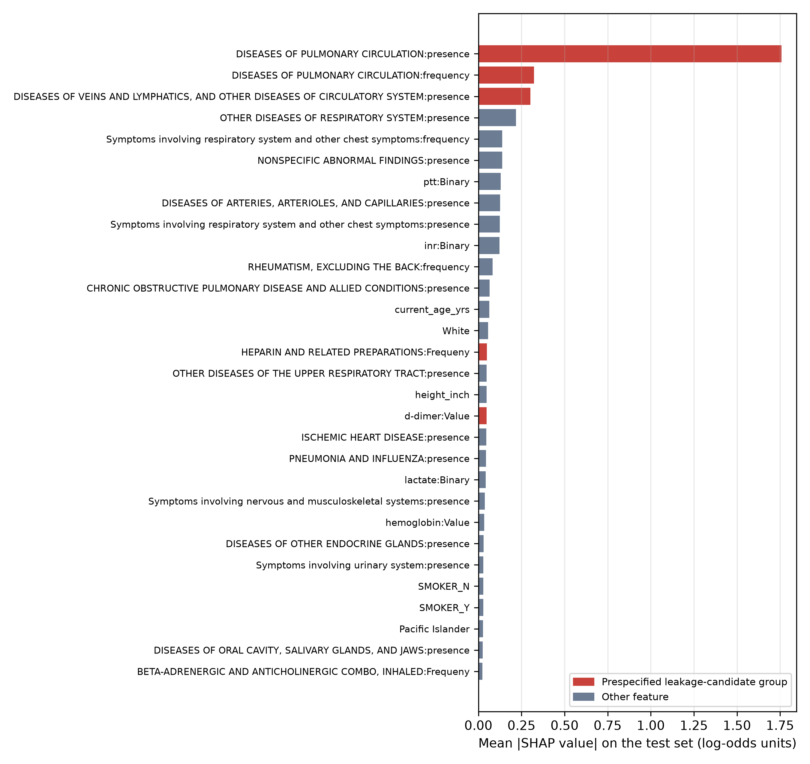

# Supplementary Appendix

*Supplementary material for: Independent Reproduction and Label-Leakage Audit of Multimodal Pulmonary Embolism Detection on the RadFusion Benchmark*

## Supplementary Figure S1

{width=6in}

**Supplementary Figure S1: Global SHAP feature importance for the EHR arm (30 highest-ranked features)**

*Bars show the mean absolute SHAP value of each feature over the 190 test studies (exact linear SHAP, training-set background, log-odds units). Red bars mark features in a prespecified leakage-candidate group. Only 199 of the 1,505 input features have non-zero attribution, a consequence of elastic-net sparsity; the two pulmonary-circulation diagnosis features account for 40.8% of the total. This figure replaces the coefficient heatmap in the original submission. Generated in Python 3.11.15 using SHAP 0.51.0 and matplotlib 3.11.2. EHR: electronic health record; SHAP: SHapley Additive exPlanations.*

## Supplementary Table S1

**Supplementary Table S1: Columns in each prespecified leakage-candidate feature group**

| Leakage-candidate group | Source table | Released column name |
|---|---|---|
| Pulmonary-circulation diagnoses | ICD diagnosis groupings | DISEASES OF PULMONARY CIRCULATION:frequency |
| Pulmonary-circulation diagnoses | ICD diagnosis groupings | DISEASES OF PULMONARY CIRCULATION:presence |
| Anticoagulant/thrombolytic medications | Outpatient medications | Outpatient_HEPARIN AND RELATED PREPARATIONS:Binary |
| Anticoagulant/thrombolytic medications | Outpatient medications | Outpatient_ANTICOAGULANTS,COUMARIN TYPE:Binary |
| Anticoagulant/thrombolytic medications | Outpatient medications | Outpatient_THROMBOLYTIC ENZYMES:Binary |
| Anticoagulant/thrombolytic medications | Outpatient medications | Outpatient_DIRECT FACTOR XA INHIBITORS:Binary |
| Anticoagulant/thrombolytic medications | Outpatient medications | Outpatient_THROMBIN INHIBITORS, SELECTIVE, DIRECT, REVERSIBLE:Binary |
| Anticoagulant/thrombolytic medications | Outpatient medications | Outpatient_HEPARIN AND RELATED PREPARATIONS:Frequeny |
| Anticoagulant/thrombolytic medications | Outpatient medications | Outpatient_ANTICOAGULANTS,COUMARIN TYPE:Frequeny |
| Anticoagulant/thrombolytic medications | Outpatient medications | Outpatient_THROMBOLYTIC ENZYMES:Frequeny |
| Anticoagulant/thrombolytic medications | Outpatient medications | Outpatient_DIRECT FACTOR XA INHIBITORS:Frequeny |
| Anticoagulant/thrombolytic medications | Outpatient medications | Outpatient_THROMBIN INHIBITORS, SELECTIVE, DIRECT, REVERSIBLE:Frequeny |
| Anticoagulant/thrombolytic medications | Inpatient medications | HEPARIN AND RELATED PREPARATIONS:Binary |
| Anticoagulant/thrombolytic medications | Inpatient medications | ANTICOAGULANTS,COUMARIN TYPE:Binary |
| Anticoagulant/thrombolytic medications | Inpatient medications | THROMBOLYTIC ENZYMES:Binary |
| Anticoagulant/thrombolytic medications | Inpatient medications | THROMBIN INHIBITORS, SELECTIVE, DIRECT, REVERSIBLE:Binary |
| Anticoagulant/thrombolytic medications | Inpatient medications | THROMBIN INHIBITORS,SEL,DIRECT,REVERS-HIRUDIN TYPE:Binary |
| Anticoagulant/thrombolytic medications | Inpatient medications | HEPARIN AND RELATED PREPARATIONS:Frequeny |
| Anticoagulant/thrombolytic medications | Inpatient medications | ANTICOAGULANTS,COUMARIN TYPE:Frequeny |
| Anticoagulant/thrombolytic medications | Inpatient medications | THROMBOLYTIC ENZYMES:Frequeny |
| Anticoagulant/thrombolytic medications | Inpatient medications | THROMBIN INHIBITORS, SELECTIVE, DIRECT, REVERSIBLE:Frequeny |
| Anticoagulant/thrombolytic medications | Inpatient medications | THROMBIN INHIBITORS,SEL,DIRECT,REVERS-HIRUDIN TYPE:Frequeny |
| D-dimer testing | Laboratory tests | d-dimer:Binary |
| D-dimer testing | Laboratory tests | d-dimer:Value |
| Venous-disease diagnoses | ICD diagnosis groupings | DISEASES OF VEINS AND LYMPHATICS, AND OTHER DISEASES OF CIRCULATORY SYSTEM:frequency |
| Venous-disease diagnoses | ICD diagnosis groupings | DISEASES OF VEINS AND LYMPHATICS, AND OTHER DISEASES OF CIRCULATORY SYSTEM:presence |

*Column names are reproduced exactly as released, including the dataset's spelling ("Frequeny"). Groups (a)–(c) were defined by the criteria in Materials & Methods (Label-leakage audit); group (d) is secondary. Only columns retained after zero-variance removal are listed. ICD: International Classification of Diseases.*

## Supplementary Table S2

**Supplementary Table S2: Sensitivity analyses (full test cohort, n=190)**

| Analysis | EHR AUROC | Average-fusion AUROC |
|---|---|---|
| Primary analysis (reference configuration: C=0.1, L1 ratio 0.99, standardization over all studies) | 0.91 | 0.94 |
| Standardization fitted on training split only | 0.89 | 0.94 |
| Elastic-net tuned by 5-fold CV grid search (selected C=0.1, l1_ratio=0.99) | 0.91 | 0.94 |
| Grid-searched elastic-net without all three prespecified groups (C=0.01, l1_ratio=0.5) | 0.75 | 0.83 |
| SVC EHR estimator (Table 2 operating point model) | 0.91 | 0.93 |

*Grid search used five-fold stratified cross-validation on the training split (1,454 studies), scored by AUROC. Cross-validated AUROC for each candidate configuration is shown below. The SVC row reports discrimination of the estimator used for the Table 5 operating point. AUROC: area under the receiver operating characteristic curve; CV: cross-validation; EHR: electronic health record; SVC: support-vector classifier.*

| C | L1 ratio | Mean 5-fold CV AUROC (training split) |
|---|---|---|
| 0.01 | 0.5 | 0.919 |
| 0.01 | 0.9 | 0.886 |
| 0.01 | 0.99 | 0.886 |
| 0.1 | 0.5 | 0.922 |
| 0.1 | 0.9 | 0.925 |
| 0.1 | 0.99 | 0.925 |
| 1.0 | 0.5 | 0.887 |
| 1.0 | 0.9 | 0.895 |
| 1.0 | 0.99 | 0.897 |

## Supplementary Table S3

**Supplementary Table S3: TRIPOD+AI reporting map**

| # | Reporting element (summarized from TRIPOD+AI) | Where reported | Status |
|---|---|---|---|
| **Title and abstract** | | | |
| 1 | Identify the study as developing or evaluating a prediction model, the target population and the outcome. | Title | Reported: reproduction and audit, RadFusion, PE detection. |
| 2 | Abstract per TRIPOD+AI for Abstracts. | Abstract | Reported (structured). |
| **Introduction** | | | |
| 3 | Healthcare context and rationale; diagnostic or prognostic. | Introduction, paragraphs 1-2 | Reported: diagnostic (study-level PE present vs absent). |
| 4 | Study objectives: development, evaluation, or both. | Introduction, final paragraph | Reported: evaluation/reproduction and leakage audit; no imaging model developed. |
| **Methods** | | | |
| 5 | Source of data; separation of development and evaluation data. | Materials & Methods: Data source, participants and selection | Reported: public RadFusion benchmark; predefined study-level splits (Table 1). |
| 6 | Participants: setting, eligibility, treatments. | Materials & Methods: Data source, participants and selection | Partially reported: selection inherited from the source benchmark [11,15,16]; no additional exclusions. |
| 7 | Outcome definition, assessment and blinding. | Materials & Methods: Data source, participants and selection | Reported: study-level PE label from the benchmark; blinding of original labelling not documented in the release. |
| 8 | Predictors: definition, timing, preprocessing. | Materials & Methods: EHR feature processing; Label-leakage audit; Table 2 | Partially reported: definitions and preprocessing reported; timing relative to index study is not available in the released data (Discussion: Temporal label leakage). |
| 9 | Sample size and justification. | Materials & Methods: Sample size | Reported: fixed by the benchmark; no a priori calculation; precision reported as 95% CIs. |
| 10 | Missing data handling. | Materials & Methods: EHR feature processing | Reported: no missing values after joining; duplicates and zero-variance columns removed. |
| 11 | Analytical methods: model type, tuning, internal validation. | Materials & Methods: EHR models; Late fusion; Supplementary Table S2 | Reported: elastic-net (fixed reference hyperparameters; CV grid search as sensitivity analysis) and SVC; fusion rules without learned parameters. |
| 12 | Class imbalance. | Materials & Methods: EHR models | Reported: balanced class weights (elastic-net). |
| 13 | Model output and thresholds. | Materials & Methods: Statistical analysis | Reported: probabilities; fixed untuned 0.5 threshold (Limitations). |
| 14 | Performance measures and rationale. | Materials & Methods: Statistical analysis | Reported: AUROC/AUPRC with bootstrap CIs, DeLong tests, Wilson CIs, likelihood ratios. |
| 15 | Model updating or recalibration. | Not applicable | Not performed. |
| 16 | Fairness. | Discussion: Limitations | Not performed; stated as a limitation. |
| 17 | Deployment considerations and intended use. | Discussion: Implications for clinical deployment | Reported as potential roles; research prototype only. |
| **Open science** | | | |
| 18 | Funding, conflicts, protocol, data and code availability. | Additional Information | Reported: no funding; no conflicts; no registered protocol; code public. |
| **Patient and public involvement** | | | |
| 19 | Patient or public involvement. | Not applicable | None: secondary analysis of a de-identified public dataset. |
| **Results** | | | |
| 20 | Participant flow and characteristics. | Results: Cohort and features; Table 1 | Reported: counts, PE prevalence and PE subtype by split. |
| 21 | Model specification. | Materials & Methods: EHR models; Table 6; public code | Reported: configuration, non-zero coefficients, SHAP ranking; full model regenerable from code. |
| 22 | Model performance with uncertainty. | Tables 3-5 and 8; Figures 2, 3 and 5 | Reported: bootstrap CIs for AUROC/AUPRC; DeLong tests; Wilson CIs. |
| 23 | Performance in subgroups. | Tables 3, 4 and 8 | Partially reported: non-subsegmental subset; demographic subgroups not assessed. |
| 24 | Results of model updating. | Not applicable | Not applicable. |
| **Discussion** | | | |
| 25 | Interpretation in context of objectives and previous studies. | Discussion | Reported, including comparison with the published benchmark. |
| 26 | Limitations. | Discussion: Limitations | Reported (dataset, model, statistical, clinical). |
| 27 | Usability and implications. | Discussion: Implications; Recommendations for multimodal benchmarking | Reported. |

*Checklist wording is summarized from Collins et al. (BMJ 2024;385:e078378). Locations refer to the unnumbered section headings of the main article. AUROC: area under the receiver operating characteristic curve; AUPRC: area under the precision-recall curve; CI: confidence interval; EHR: electronic health record; PE: pulmonary embolism; SHAP: SHapley Additive exPlanations; SVC: support-vector classifier.*
